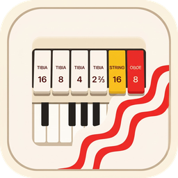

<p align="center">
  
</p>

<h1 align="center">KE-310 Organ</h1>
<p align="center">
  <strong>Retro Home Organ Series #1</strong> by <strong>Yuguen Organ (ゆうげんオルガン)</strong><br>
  1979 Analog Transistor Home Organ Simulator &mdash; VST3 / macOS AudioUnit (AU) / Standalone
</p>
<p align="center">
  <em>Current Status: Public Alpha (<code>v0.1.0-alpha</code>) &bull; License: GPLv3</em>
</p>

<p align="center">
  
</p>

---

## Overview / 概要

**KE-310 Organ** is the first instrument in the **Retro Home Organ Series** developed by **Yuguen Organ (ゆうげんオルガン)**.
It models the tone generators, divider architecture, analog formant filters, keying/envelope buses, spring reverb, and built-in hornless rotary drum speaker of the 1979 KE-310 transistor home organ in real-time C++20 DSP (`JUCE 8`).

**KE-310 Organ** は、**Yuguen Organ（ゆうげんオルガン）** が贈る **Retro Home Organ Series 第1弾** です。
1979年製トランジスタ電子オルガン（KE-310）の音源・分周器・フォルマントフィルタ・キーイング回路・スプリングリバーブ・内蔵ホーンなしロータリードラムスピーカーを、リアルタイム C++20 DSP（JUCE 8）で再現した VST3 / AU / Standalone インストゥルメントです。

> [!NOTE]
> This is an **Alpha release (`v0.1.0-alpha`)**. Feedback, bug reports, and DAW compatibility reports via GitHub Issues are welcome.

---

## Key Features / 主な機能

- **3-Manual Organ Architecture (49 / 49 / 13 Keys)**
  - **Upper Manual (49 keys, C3–C7)**: 10 tone levers (`TIBIA 16'/8'/4'/2 2/3'`, `DIAPASON 8'`, `STRING 16'/8'/4'`, `OBOE 8'`, `CLARINET 8'`) + `UPPER SUSTAIN`
  - **Lower Manual (49 keys, C2–C6)**: 6 tone levers (`TIBIA 8'/4'`, `DIAPASON 8'`, `STRING 8'/4'`, `HORN 8'`)
  - **Pedalboard (13 keys, C2–C3)**: 3 tone levers (`BOURDON 16'`, `MAJOR FLUTE 8'`, `STRING BASS`), authentic low-note priority monophonic VCO + `PEDAL SUSTAIN`
- **Upper Preset Section**:
  - `ORGAN SILENT`, `PERCUS. 2 2/3'` (single-trigger legato behavior), `WOW TRUMPET` (envelope-triggered wah sweep with legato carry-over), `BANJO`, `MANDOLIN`, `MARIMBA` (alternating 8'/4' repeat VCA), `PIANO`, `HARPSICHORD`
  - Authentic shared 8'/4' decay keying behavior (`PIANO` / `HARPSICHORD` + `UPPER SUSTAIN` interaction matching hardware circuit behavior)
- **Built-in Hornless Rotary Drum Speaker & Effects**:
  - Mechanical **single-rotor drum model** with smooth asymmetric motor acceleration/deceleration inertia: `CHORUS` (Slow), `TREMOLO` (Fast), and Brake (both OFF)
  - User-adjustable **Rotary Slow (Hz)** and **Rotary Fast (Hz)** speeds
  - `VIBRATO`, `VIBRATO FAST`, `DELAY VIBRATO` (disabled automatically when `PIANO` / `HARPSICHORD` active, just like hardware), `ENSEMBLE` (routes Stationary voices into Rotor), `REVERB` (spring tank model), and loudness-compensated `EXPRESSION` pedal
- **3-Stereo-Bus Multi-Out (DAW Flexibility)**:
  - `Main Mix` (Stereo) + `Rotor Out` (Stereo) + `Stationary Out` (Stereo)
  - When both `CHORUS` and `TREMOLO` are OFF, `Rotor Out` passes completely dry (bit-exact bypass) so DAW users can freely insert external rotary speaker or guitar/organ amp plugins per bus
- **28 Built-in Registration Presets & Flexible MIDI Routing**:
  - Multi-Channel mode (`Upper / Lower / Pedal` independently assignable to `Omni / Ch 1..16 / Off`) and Single-Keyboard Split mode
  - Octave shifts (`-2..+2`), optional pedal octave folding, physical key range clamp toggle, MIDI `CC#11` Expression, `CC#7` Volume, and `CC#64` Knee Sustainer

---

## Download & Installation / ダウンロードと導入方法

Pre-built binaries are published on the [GitHub Releases](../../releases) page (`.zip` archives for **Windows x64**, **macOS Universal arm64+x86_64**, and **Linux x64**).

### Windows (x64)
- **VST3**: Copy `KE-310 Organ.vst3` into `C:\Program Files\Common Files\VST3\`
- **Standalone**: Run `KE-310 Organ.exe` directly from any folder
- **Audio Driver Note**: The Standalone app uses **Windows Audio (WASAPI Shared / Exclusive / Low Latency)** and **DirectSound** (it does not bundle proprietary ASIO drivers). If you prefer using an ASIO audio interface directly, please load `KE-310 Organ.vst3` inside an ASIO-compatible DAW or VST3 host.

### macOS (Apple Silicon + Intel Universal)
- **VST3**: Copy `KE-310 Organ.vst3` to `/Library/Audio/Plug-Ins/VST3/`
- **AudioUnit (AU)**: Copy `KE-310 Organ.component` to `/Library/Audio/Plug-Ins/Components/`
- **Standalone**: Copy `KE-310 Organ.app` to `/Applications/`

> [!IMPORTANT]
> **macOS Gatekeeper Notice (Alpha Unsigned Builds)**
> Because alpha builds are not yet Apple-notarized, macOS may show a *"cannot be opened / damaged"* warning on first launch. After copying the files, clear the quarantine attribute in Terminal:
> ```bash
> xattr -cr "/Library/Audio/Plug-Ins/VST3/KE-310 Organ.vst3"
> xattr -cr "/Library/Audio/Plug-Ins/Components/KE-310 Organ.component"
> xattr -cr "/Applications/KE-310 Organ.app"
> ```

### Linux (x64)
- **VST3**: Copy `KE-310 Organ.vst3` to `~/.vst3/`
- **Standalone**: Make `KE-310 Organ` executable (`chmod +x "KE-310 Organ"`) and run it

---

## Build from Source / ソースからのビルド

Requirements: CMake >= 3.22, a C++20 compiler, Git, and internet access (to fetch JUCE 8.0.6 and Catch2 v3.7.1 via `FetchContent`).

```bash
# Configure & Build (Release VST3 / AU / Standalone / Catch2 Tests)
cmake -B build -DCMAKE_BUILD_TYPE=Release
cmake --build build --parallel

# Run all 19 Catch2 DSP & Plugin unit tests
ctest --test-dir build --output-on-failure -V
```

*(On Linux, pass `-G Ninja` if using Ninja; on macOS Universal builds, add `-DCMAKE_OSX_ARCHITECTURES="arm64;x86_64"`.)*

---

## License & Disclaimer / ライセンス・免責事項

- **License**: Released under the **GNU General Public License v3.0 (GPLv3)** (compatible with JUCE 8 open-source licensing). The copyright holder (**Yuguen Organ**) retains the right to distribute this software under separate commercial or proprietary license terms. By submitting a Pull Request or contribution to this repository, you agree that your contribution may be licensed and distributed under both GPLv3 and separate commercial terms; see [LICENSE](LICENSE) for full details.
- **Framework**: Built with [JUCE 8](https://juce.com/).
- **Disclaimer**: *KE-310 Organ* is an independent software modeling project created by **Yuguen Organ (ゆうげんオルガン)**. It is not affiliated with, endorsed by, or sponsored by any hardware musical instrument manufacturer. All stop names refer to traditional electronic organ registration terminology.
